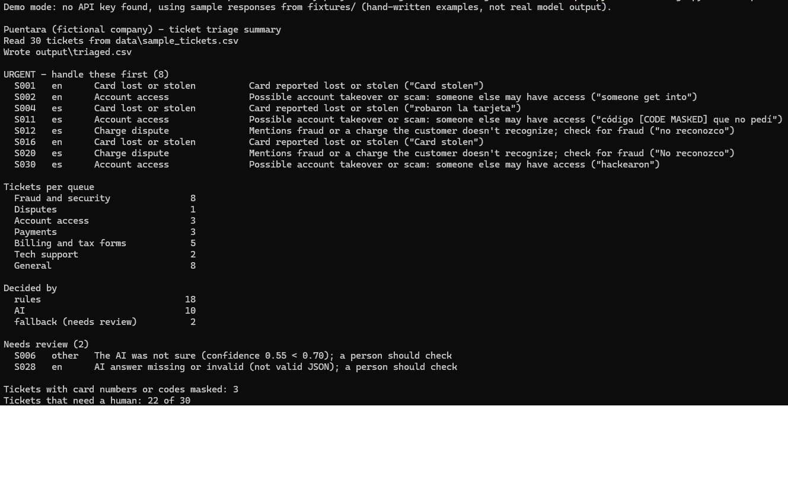

# Bilingual Ticket Triage (EN/ES)

Sorts a CSV of English and Spanish support tickets into queues by category and urgency, so a lost card never waits behind a password question. A person decides every case.

> **Demo scenario.** Puentara is a fictional money app for freelancers and small businesses in the US and Latin America. All tickets in this repo are synthetic.

## The problem

Tickets arrive in one long list, in two languages. Someone has to read each one to find the urgent ones: a stolen card, a charge the customer doesn't recognize, someone else logged into the account. While that happens, a fraud ticket can sit behind ten "what are your hours?" questions. And Spanish tickets often wait for whoever on the team reads Spanish.

## What it does

- Reads a helpdesk CSV export (UTF-8, or Excel's Windows "CSV (Comma delimited)"). Common header names like `id`, `title` or `description` are accepted, so most exports work without renaming columns.
- Masks card numbers, CVVs and one-time codes **before** anything else reads the ticket. The masked text is what the rules see, what the AI receives and what the output file stores.
- Detects the language of each ticket: English, Spanish, mixed, or other.
- Tags each ticket with a category, an urgency and a queue, using bilingual keyword rules for the clear cases.
- Sends only the unclear tickets to the AI (Claude). In demo mode, the AI answers come from hand-written fixtures instead.
- Applies safety floors: the AI can raise urgency but can never lower it below what the rules or the category require.
- Sends anything the AI was unsure about, or answered badly, to a "needs review" list instead of guessing.
- Writes `output/triaged.csv` (your original columns plus the triage columns) and prints a routing summary in English or Spanish.
- Includes `evaluate.py`, which scores the rules on a labeled synthetic test set of 150 tickets.

Categories: account access, identity verification, card lost or stolen, failed or pending transfer, charge dispute, fees, tax forms, app bug, general question.

Queues: fraud and security, disputes, account access, payments, billing and tax forms, tech support, general.

## Quick start

You need **Python 3.11 or newer**. No API key is needed for the demo.

### 1. Get the code

Once the repo is public:

```
git clone https://github.com/RawBud11/bilingual-ticket-triage.git
cd bilingual-ticket-triage
```

On Windows, clone into a short folder path such as `C:\dev\`. Very long paths can break the virtual environment step with a "filename too long" error.

### 2. Create a virtual environment and install

PowerShell (Windows):

```powershell
python -m venv .venv
.venv\Scripts\Activate.ps1
pip install -r requirements.txt
```

bash (macOS, Linux, Git Bash):

```bash
python3 -m venv .venv
source .venv/bin/activate
pip install -r requirements.txt
```

**If PowerShell blocks `Activate.ps1`** (an "execution policy" error), skip activation. Call the venv's Python directly instead:

```powershell
.venv\Scripts\python.exe -m pip install -r requirements.txt
.venv\Scripts\python.exe triage.py data/sample_tickets.csv
```

The bash equivalent without activation is `.venv/bin/python -m pip install -r requirements.txt` and `.venv/bin/python triage.py data/sample_tickets.csv`.

**Faster install:** `pip install --no-compile -r requirements.txt`. Most of the install time goes into compiling the `anthropic` SDK's files, and this skips that step.

### 3. Run the demo (no API key)

```
python triage.py data/sample_tickets.csv --out output/triaged.csv
python triage.py data/sample_tickets.csv --out output/triaged.csv --summary-lang es
python evaluate.py
python evaluate.py --summary-lang es
```

Without a key, the tool prints a "Demo mode" line and uses `fixtures/ai_responses.json`. Those AI answers are **hand-written examples, not real model output**. The rules, masking, routing and safety floors all run for real.

### 4. Run the tests

```
python -m pytest -q
```

All tests run offline, with no API key.

### 5. Optional: live mode with your own key

Copy the example settings file and add your key:

```powershell
Copy-Item .env.example .env
```

```bash
cp .env.example .env
```

Then edit `.env`:

```
ANTHROPIC_API_KEY=your-key-here
ANTHROPIC_MODEL=claude-haiku-5-5
```

Real API calls only happen when you add `--live`. A key in `.env` alone does not turn them on.

```
python triage.py data/sample_tickets.csv --live
python evaluate.py --live
```

The model name comes from `ANTHROPIC_MODEL` in `.env`. If it is not set, the default in `config.py` is used. **I have not yet verified live mode with a real key**, so treat it as untested until I do. `--live --record` also saves the real answers to `fixtures/` so demo mode can replay them.

### PowerShell 5.1 and accents

The plain console output and the CSV file show accents correctly. But Windows PowerShell 5.1 garbles accents (á, ñ, ¿) when you **pipe or capture** the output, for example into `Out-File` or `Select-String`. Run this first in the same window:

```powershell
[Console]::OutputEncoding = [Text.Encoding]::UTF8
```

## Example output

Real captured output from `docs/demo_output.txt`. Windows 11, demo mode, no API key, 30 synthetic tickets.



```
PS> .venv\Scripts\python.exe triage.py data/sample_tickets.csv --out output/triaged.csv
Demo mode: no API key found, using sample responses from fixtures/ (hand-written examples, not real model output).

Puentara (fictional company) - ticket triage summary
Read 30 tickets from data\sample_tickets.csv
Wrote output\triaged.csv

URGENT - handle these first (8)
  S001   en      Card lost or stolen          Card reported lost or stolen ("Card stolen")
  S002   en      Account access               Possible account takeover or scam: someone else may have access ("someone get into")
  S004   es      Card lost or stolen          Card reported lost or stolen ("robaron la tarjeta")
  S011   es      Account access               Possible account takeover or scam: someone else may have access ("código [CODE MASKED] que no pedí")
  S012   es      Charge dispute               Mentions fraud or a charge the customer doesn't recognize; check for fraud ("no reconozco")
  S016   en      Card lost or stolen          Card reported lost or stolen ("Card stolen")
  S020   es      Charge dispute               Mentions fraud or a charge the customer doesn't recognize; check for fraud ("No reconozco")
  S030   es      Account access               Possible account takeover or scam: someone else may have access ("hackearon")

Tickets per queue
  Fraud and security               8
  Disputes                         1
  Account access                   3
  Payments                         3
  Billing and tax forms            5
  Tech support                     2
  General                          8

Decided by
  rules                           18
  AI                              10
  fallback (needs review)          2

Needs review (2)
  S006   other   The AI was not sure (confidence 0.55 < 0.70); a person should check
  S028   en      AI answer missing or invalid (not valid JSON); a person should check

Tickets with card numbers or codes masked: 3
Tickets that need a human: 22 of 30
```

The "AI" count here comes from the hand-written fixtures, not from a real model. S006 (French) and S028 (a deliberately broken fixture) show what happens when the AI can't give a good answer: the ticket goes to a person.

### The same summary in Spanish

```
PS> .venv\Scripts\python.exe triage.py data/sample_tickets.csv --out output/triaged.csv --summary-lang es
Modo demo: no se encontró una clave de API, se usan respuestas de ejemplo de fixtures/ (ejemplos escritos a mano, no son respuestas reales del modelo).

Puentara (empresa ficticia) - resumen de clasificación de tickets
Se leyeron 30 tickets de data\sample_tickets.csv
Se escribió output\triaged.csv

URGENTES - atiéndelos primero (8)
  S001   en      Tarjeta perdida o robada     Reporta una tarjeta perdida o robada ("Card stolen")
  S002   en      Acceso a la cuenta           Posible robo de cuenta o estafa: alguien más podría tener acceso ("someone get into")
  S004   es      Tarjeta perdida o robada     Reporta una tarjeta perdida o robada ("robaron la tarjeta")
  ...
```

### Masking in a Spanish ticket (S004)

The customer typed their full card number and CVV into the ticket:

```
Me robaron la tarjeta en el metro. El número es 0000 1043 3218 1960 y el CVV 529, por favor bloquéenla.
```

The row written to `output/triaged.csv` (from the `--summary-lang es` run):

```
ticket_id,created_at,channel,subject,body,language,category,urgency,sentiment,queue,needs_human,needs_review,decided_by,confidence,reason,sensitive_data_masked
S004,2026-10-12 09:28,web_form,Tarjeta robada,"Me robaron la tarjeta en el metro. El número es [CARD NUMBER MASKED] y el CVV [CODE MASKED], por favor bloquéenla.",es,card_lost_stolen,urgent,,fraud_security,true,false,rule,,"Reporta una tarjeta perdida o robada (""robaron la tarjeta"")",true
```

The card number and CVV never reach the rules, the AI or the output file. (The card numbers in the sample data are made up and start with `0000`, which no real card does.)

### Evaluation (rules layer only)

```
PS> .venv\Scripts\python.exe evaluate.py
Synthetic sample data (template-generated). These numbers show the tool works on this test set, not how accurate it would be on real tickets.
Mode: rules layer only (demo, no API calls). Run with --live for full-pipeline numbers.

  Tickets in test set                           150
  Rules coverage (decided by rules)             132/150 (88.0%)
  Category accuracy, rule-decided tickets       132/132 (100.0%)
  Urgency accuracy, rule-decided tickets        132/132 (100.0%)
  Urgent-ticket recall (rules alone)            38/39 (97.4%)

Misses (1)
  T148  expected: card_lost_stolen/urgent  got: -/normal (not decided)
        Se me perdió la trajeta en el taxi, necesito una nueva.
```

**Read these numbers carefully.** The test set is **template-generated synthetic data**. These numbers show the tool works on this set. They are not real-world accuracy.

- The 100% on rule-decided tickets is high because the test tickets come from the **same templates** the rules were written against (with a different random seed). Real tickets are messier.
- These are **rules-layer numbers only** (demo mode). The AI layer is not scored in demo mode, because its answers there are hand-written. Full-pipeline numbers need `evaluate.py --live`, which I have not run yet.
- The one miss, T148, is an honest one: the customer typed "trajeta" instead of "tarjeta", so no rule matched. I left it in on purpose.

## Output columns

`output/triaged.csv` keeps your original columns (with subject and body masked) and adds:

| Column | Meaning |
|---|---|
| `language` | `en`, `es`, `mixed` or `other` |
| `category` | one of the 9 categories, or blank if a person must decide |
| `urgency` | `low`, `normal`, `high` or `urgent` |
| `sentiment` | `positive`, `neutral` or `negative`. **Blank for rule-decided tickets**: only the AI fills it in. |
| `queue` | which team should pick it up |
| `needs_human` | `true` for money, fraud, disputes, access and anything unclear |
| `needs_review` | `true` when nobody could decide with confidence |
| `decided_by` | `rule`, `ai` or `fallback` |
| `confidence` | the AI's confidence from 0 to 1. **Blank for rule-decided tickets.** |
| `reason` | one short sentence, in the summary language, quoting the words that triggered a rule |
| `sensitive_data_masked` | `true` if a card number, CVV or code was hidden |

## How it works

Each ticket goes through the same steps. First, card numbers and codes are masked. Then the language is detected by counting common English and Spanish words. Keyword rules in both languages handle the clear cases. Urgent patterns (stolen card, account takeover, a charge the customer doesn't recognize) always win, even if the ticket mentions something else too. Tickets with no match, or with two different topics, go to the AI with a fixed list of categories. The AI's answer is checked: wrong format or low confidence (under 0.70) sends the ticket to review. Last, the safety floors and the routing table in `config.py` decide the queue.

```
ticket -> mask card numbers/codes -> detect language -> rules
             |                                          |
             |                          clear case -----+---- unclear
             |                              |                   |
             |                              |          AI (or demo fixtures)
             |                              |                   |
             |                              +---- floors + routing table ----> queue, CSV, summary
```

Main files:

| File | What it does |
|---|---|
| `triage.py` | Command line: reads the CSV, runs each ticket, writes the CSV and prints the summary |
| `config.py` | Categories, queues, the escalation table, urgency floors, model and column names |
| `ticket_triage/mask.py` | Masks card numbers, CVVs and one-time codes |
| `ticket_triage/language.py` | Detects English, Spanish, mixed or other |
| `ticket_triage/rules.py` | Bilingual keyword rules and the order they are applied in |
| `ticket_triage/ai.py` | Builds the AI request, calls Claude or reads fixtures, checks the answer |
| `ticket_triage/route.py` | Puts it all together for one ticket and applies the safety floors |
| `ticket_triage/strings.py` | All English and Spanish text shown to the team |
| `prompts/triage_system.txt` | The instructions the AI gets |
| `evaluate.py` | Scores the rules on `data/test_labeled.csv` |
| `scripts/make_tickets.py` | Generates the synthetic tickets (`python scripts/make_tickets.py --seed 42`) |

If you regenerate the tickets with a different seed or edit the templates, the ticket IDs in `fixtures/ai_responses.json` can point to different tickets. Re-record them with `--live --record` or edit them by hand.

## Safety and support rules

These come from real support work:

- **The tool writes nothing to customers.** It only sorts tickets. The AI suggests a category; a person decides what happens.
- **Money, fraud, disputes and account access always go to a human.** `needs_human` is `true` for every one of those categories, whoever decided it.
- **Urgent means fraud, a lost or stolen card, or someone else in the account.** Every urgent ticket goes to the fraud and security queue.
- **The AI can't make a ticket less urgent.** Rules and categories set a minimum urgency. A dispute stays at least "high", a stolen card stays "urgent".
- **No guessing.** Missing, broken or low-confidence AI answers go to "needs review" with a blank category.
- **Sensitive numbers are masked first.** Card numbers, CVVs and one-time codes are hidden before the rules, the AI or the output file see them.
- **Ticket text can't give the AI orders.** The ticket is wrapped in tags, and any `<ticket>` tags the customer typed are removed, so a ticket can't pretend to be instructions.
- **Tax forms get no tax advice.** They go to the billing and tax queue for a person.

This is a demo project. It does not claim any compliance certification.

## Limitations

- **Masking covers card numbers, CVVs and one-time codes only.** It does not mask names, emails, addresses, or passwords typed in plain text.
- **The code mask is deliberately broad.** It also hides harmless numbers after words like "code" or "código", such as "error code 5003" or "código postal 11000". Hiding too much is safer than too little.
- **Fraud mentions over-escalate on purpose.** "How do I report fraud?" is marked urgent. That is the safe direction: a person can lower it in seconds, but a missed fraud case costs much more.
- **Only English and Spanish.** Language detection is word counting. Portuguese can be read as Spanish. Anything else is marked `other` and goes to review.
- **Typos can slip past the rules**, like "trajeta" in T148. In live mode, the AI would see those tickets.
- **The mask labels stay in English** (`[CARD NUMBER MASKED]`) inside Spanish tickets.
- **Live mode is not yet verified** with a real key, and the AI layer has no measured accuracy yet.
- **It reads CSV exports**, not a live helpdesk connection.

## Ideas for next steps

- Mask "my password is ..." and "mi contraseña es ..." phrases.
- Write one CSV per queue, so each team opens only its own tickets.
- Read richer Zendesk or Freshdesk exports (tags, requester language) and use them as hints.
- Connect to a helpdesk API to tag tickets as they arrive.

## About the data

All sample data and the demo company are fictional. Puentara is not a real company. The tickets are synthetic and come from `scripts/make_tickets.py`. The card numbers are made up and start with `0000`. No real customer or bank data is used anywhere in this repo.

## How this was built

Built with AI-assisted development tools; I planned, reviewed and tested it.

## License

MIT. See [LICENSE](LICENSE).

---

Have tickets in English and Spanish piling up? Send me a small sample of sanitized, non-sensitive tickets, and I'll show you how this would sort them.
